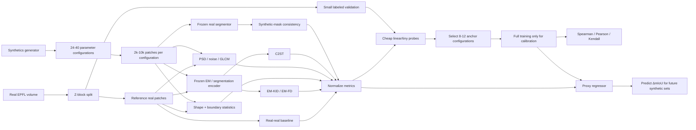

# Метрики сходства синтетических и реальных EM-данных EPFL как прокси качества сегментации

## Краткое резюме

Для вашего генератора **GraphLabEMproj/Synthetics** я бы не искал одну универсальную «метрику реалистичности». Более перспективна **небольшая панель из трёх независимых типов сигналов**, потому что полезность синтетики для сегментации определяется как минимум тремя различными вещами: похожестью локальной текстуры/шума, похожестью геометрии объектов и тем, насколько синтетика попадает в представление признаков, полезное именно для сегментации. Недавние исследования синтетических данных для сегментации также показывают, что высокая визуальная реалистичность сама по себе недостаточна: важны композиция сцены и fidelity отдельных объектов, то есть пространственная структура данных. citeturn21view0turn18view3

**Моя основная рекомендация для вашего случая:**

> **Главная метрика:** class-conditional **KID/MMD в признаках замороженного EM/segmentation encoder**  
> **+ геометрический distance по маскам каждого класса**  
> **+ PSD/texture/noise distance**  
> **+ как наиболее task-aware проверка — frozen-segmentor consistency.**

То есть вместо одного `FID` получить вектор примерно такого вида:

\[
Q(S,R)=
[
D_{\rm feat},\,
D_{\rm shape},\,
D_{\rm PSD},\,
D_{\rm texture},\,
D_{\rm C2ST},\,
Q_{\rm seg}
]
\]

а после первоначальной калибровки на нескольких уже известных экспериментах свернуть его в прогноз ожидаемого `mIoU/DSC`.

Это особенно хорошо соответствует вашему генератору. В `EPFL.json` непосредственно параметризуются интенсивности, blur, Poisson noise, толщина мембран, цвета/интенсивности митохондрий и крист, размеры митохондрий, PSD и везикул; следовательно, многие физически содержательные компоненты domain gap можно измерять напрямую, не обучая сегментатор заново. citeturn17view6 Генератор работает с изображениями `256×256` и явно строит слои PSD, axon, membranes, mitochondria, mitochondrial border и vesicles, что делает **class-conditional статистики геометрии и текстуры особенно доступными**. citeturn18view0

Есть важная деталь в текущем репозитории: `calculate_FID.py` **не вычисляет классический Fréchet Inception Distance**. Код строит histogram intensity для real/synthetic, вычисляет среднее и стандартное отклонение гистограмм и возвращает

\[
(\mu_r-\mu_s)^2+(\sigma_r-\sigma_s)^2.
\]

Причём это делается отдельно для axon, membrane, mitochondria, mitochondrial boundary, vesicles и PSD. citeturn17view0turn17view2 Я бы эту метрику **не удалял** — она полезна как очень дешёвая class-conditional photometric metric, — но переименовал, например, в `HistogramMomentDistance`, потому что настоящий FID определяется в пространстве признаков нейросети и сравнивает многомерные средние и ковариации. FID был введён Heusel et al. именно как feature-space distribution distance. citeturn18view5

Для EPFL это особенно важно: исходный набор представляет CA1 hippocampus volume `1065×2048×1536` с размером voxel приблизительно `5×5×5 nm`; официальная страница предоставляет два размеченных подтома по 165 slices, но официально документированная ground truth относится **к митохондриям**. citeturn16view0 Поэтому ваши шесть классов — фактически расширенная постановка поверх EPFL, и при разработке proxy-метрики следует использовать именно ваши шестиклассовые маски, а не предполагать, что официальный EPFL содержит six-class ground truth.

Самый важный методологический вывод: **нельзя математически гарантировать хорошую сегментацию только из близости маргинальных распределений изображений \(p(x)\)**. Теория domain adaptation показывает, что близость source и target distributions сама по себе недостаточна без предположений о совместимости labeling functions. citeturn18view8 Поэтому окончательную surrogate-метрику надо один раз откалибровать на небольшом наборе generator configurations, для которых реальный downstream IoU уже известен или будет измерен. После такой калибровки полное переобучение для каждой новой конфигурации уже не потребуется.

**Приоритет для практической реализации:**

| Приоритет | Метрика | Что она ловит | Ожидаемая связь с mIoU/DSC* | Стоимость после подготовки |
|---|---|---|---|---|
| **S** | Class-conditional EM-KID/MMD | распределение task-relevant features | **высокая** | низкая–средняя |
| **S** | Shape/Boundary Wasserstein | геометрия 6 классов | **высокая** | очень низкая |
| **S** | Frozen segmentation consistency | непосредственно пригодность объектов для segmentation representation | **очень высокая** | inference-only |
| **A** | C2ST в EM feature space | насколько легко отличить synthetic от real | высокая | низкая |
| **A** | PSD + noise/texture distance | SEM noise, blur, spatial frequencies | средняя–высокая | очень низкая |
| **A** | EM-Fréchet Distance | глобальное feature distribution | средняя–высокая | низкая |
| B | SimCLR/AE/VAE latent MMD | latent-domain gap | средняя–высокая | низкая после обучения encoder |
| B | GLCM/LBP texture | локальная текстура | средняя | очень низкая |
| C | LPIPS | perceptual feature similarity | низкая–средняя | средняя |
| C | vanilla ImageNet FID | generic feature gap | низкая–средняя | средняя |
| D | SSIM / PSNR / MSE | paired pixel distortion | низкая без correspondence | очень низкая |

\*Это **априорная гипотеза именно для вашего генератора**, а не уже измеренный результат на EPFL. Цель предлагаемого эксперимента ниже — проверить и количественно оценить эту колонку.

## Что именно нужно сравнивать в EPFL и вашем генераторе

EPFL — особенно удачный случай для такой работы, поскольку это не набор независимых natural images, а пространственно связанный EM volume. Официально это участок CA1 hippocampus размером около \(5\times5\times5\,\mu m\) с почти изотропными `5 nm` voxels. citeturn16view0 Отдельная работа, использовавшая именно этот публичный EPFL volume, описывает его как FIB-SEM и показывает, что межсрезовый drift способен искажать 3D-геометрию; авторы, в частности, использовали геометрию synaptic vesicles для оценки такого drift. citeturn20search7

Из этого следует принципиальная вещь: сравнивать надо не только

\[
p(I_{\rm real}) \overset{?}{\approx} p(I_{\rm synth}),
\]

а желательно приближать

\[
p(I,Y,G,T),
\]

где \(I\) — изображение, \(Y\) — semantic class, \(G\) — geometry, \(T\) — texture/noise.

Для вашего генератора это практически реализуемо, поскольку synthetic mask известна **идеально и бесплатно**. В текущем коде возвращаются image и слои PSD, axon, membrane, mitochondria, mitochondrial boundary и vesicles. citeturn18view0 Более того, существующий скрипт сравнения уже использует практически ту же семантику классов при class-conditional intensity histograms. citeturn17view2

Я бы формально разделил domain gap на четыре части:

\[
D_{\rm total} =
w_aD_{\rm appearance}
+w_gD_{\rm geometry}
+w_fD_{\rm features}
+w_tD_{\rm task}.
\]

Здесь веса **не следует задавать вручную навсегда**. Их лучше оценить regression model по историческим segmentation experiments.

Особенно полезно, что параметры вашего `EPFL.json` естественно отображаются на метрики:

| Параметры генератора | Наблюдаемая величина в real EM | Предпочтительная метрика |
|---|---|---|
| `main_color_mean/std` | histogram / intensity distribution | Wasserstein histogram, текущий histogram-moment distance |
| `main_noise_*`, `poisson_noise` | variance, high-frequency spectrum, autocorrelation | noise PSD, residual distribution |
| Gaussian blur | loss of high frequencies | radial PSD, gradient spectrum |
| `membrane_thickness_*` | membrane-width distribution | distance между thickness distributions |
| mitochondria colors | conditional intensity | class-conditional histogram / GLCM |
| `mit_len_min/max` | mitochondrial size/axis statistics | Wasserstein over major axis/area |
| `mitochondrion_border_w_*` | boundary width | boundary thickness distribution |
| vesicle border/appearance | vesicle radius, circularity, texture | regionprops + PSD/GLCM |
| PSD intensity parameters | conditional contrast/texture | class-conditional texture features |

Эти параметры присутствуют непосредственно в EPFL configuration генератора. citeturn17view6

Ещё одна причина предпочесть **многоаспектную оценку**: исследования generative medical imaging обнаруживают случаи, когда методы имеют лучшие conventional upstream distances, но худшую downstream segmentation utility; например, в одном сравнении ranking VAE/GAN по upstream metrics противоречил downstream vessel-segmentation score. Это не EM и поэтому является косвенным evidence, но методологический вывод хорошо переносится: distributional fidelity и task utility не эквивалентны. citeturn18view2turn18view3

## Приоритетные метрики

Ниже `↑` означает «больше = лучше», `↓` — «меньше = лучше». Стоимость дана для уже подготовленных patches/features.

### Pixel-level metrics

**MSE / PSNR.**

\[
\operatorname{MSE}(x,y)=\frac1N\sum_i(x_i-y_i)^2,
\qquad
\operatorname{PSNR}=10\log_{10}\frac{MAX^2}{MSE}.
\]

Они требуют того, чтобы изображения \(x\) и \(y\) описывали примерно один и тот же объект в одном месте. Для случайного real EPFL patch и случайного synthetic patch такого correspondence нет, поэтому MSE/PSNR в вашей основной задаче концептуально почти бессмысленны.

Стоимость — \(O(HW)\), практически нулевая. Чувствительность к imbalance очень высокая: background занимает большую площадь и доминирует. К geometry они чувствительны чрезмерно буквально: translation объекта на несколько pixels резко ухудшает score, даже если distributions полностью идентичны.

**Ожидаемая корреляция с mIoU: низкая.** Использовать MSE/PSNR следует только в специальных paired experiments — например, когда вы искусственно добавляете blur/noise к одному и тому же real patch и хотите проверить monotonicity proxy.

Универсального рабочего threshold для вашей задачи нет.

**SSIM.**

SSIM сравнивает локальные luminance, contrast и structure:

\[
SSIM(x,y)=
\frac{(2\mu_x\mu_y+C_1)(2\sigma_{xy}+C_2)}
{(\mu_x^2+\mu_y^2+C_1)(\sigma_x^2+\sigma_y^2+C_2)}.
\]

SSIM разрабатывался именно как full-reference structural quality metric, то есть для сравнения исходного изображения с его искаженной версией, а не двух независимых выборок. citeturn19search0

В отличие от MSE, SSIM лучше реагирует на локальную структуру, но проблема отсутствия correspondence остаётся. Для EPFL он пригоден для тестирования **paired synthetic corruptions**, но не как основной real-vs-synthetic metric.

Стоимость очень низкая; imbalance высокий; geometry sensitivity средняя–высокая; ожидаемая корреляция с mIoU в unpaired setup низкая.

**Вывод:** MSE/PSNR/SSIM оставить как diagnostics, но не использовать при выборе параметров генератора.

### Feature-level metrics

**Обычный FID.**

Классический FID извлекает feature vectors \(z=f(x)\) и аппроксимирует real и synthetic distributions гауссовскими:

\[
FID =
\|\mu_r-\mu_s\|_2^2+
\operatorname{Tr}
\left(
\Sigma_r+\Sigma_s
-2(\Sigma_r\Sigma_s)^{1/2}
\right).
\]

FID был предложен как measure similarity generated-real distributions в Inception representation. citeturn18view5

Для RGB natural images это стандартный baseline. Для grayscale brain EM возникает проблема: **ImageNet Inception representation не оптимизировано под membranes, mitochondrial cristae, vesicles и EM noise**. Поэтому я бы вычислял vanilla FID только как контроль.

Стоимость: извлечение features \(O(nC_{\rm encoder})\), затем covariance и matrix square root; после кеширования real features — дёшево.

Class imbalance: высокий для global FID. Решение — `FID_c` для patches/crops каждого класса и macro average:

\[
FID_{\rm macro}=\frac1{6}\sum_{c=1}^6 FID_c.
\]

Geometry sensitivity: средняя. Expected IoU correlation: низкая–средняя для Inception, предположительно существенно выше для EM/segmentation encoder.

**EM-FD — рекомендуемая модификация.** Заменить Inception на encoder, который вы уже использовали в segmentation network, или на self-supervised encoder, один раз обученный на real EPFL. Тогда та же Fréchet formula применяется к feature space, более релевантному ultrastructure.

**KID / MMD — мой фаворит среди distribution distances.**

KID — kernel-based вариант сравнения двух feature distributions, основанный на MMD. Авторы KID предложили его как альтернативную measure convergence generative models. citeturn18view6

Для kernel \(k\):

\[
MMD^2(P,Q)=
E[k(x,x')]
+E[k(y,y')]
-2E[k(x,y)].
\]

Для KID обычно берётся polynomial kernel на feature vectors. Практически:

\[
k(x,y)=\left(\frac{x^\top y}{d}+1\right)^3.
\]

Сильная сторона для вашей задачи — KID можно считать на **EM-specific embeddings** и легко делать class conditional:

\[
D_{\rm EM-KID}
=
\frac1{6}\sum_{c=1}^{6}KID(Z^r_c,Z^s_c).
\]

Стоимость exact MMD \(O(n^2d)\), но при 500–2000 features на class или при repeated random subsets она вполне умеренная.

Чувствительность к imbalance низкая при macro averaging. Geometry sensitivity высокая, если encoder сохраняет spatial/morphological information.

**Ожидаемая корреляция: высокая.**

Абсолютного KID threshold нет. Правильная калибровка — сравнение с `real-vs-real` floor, описанное ниже.

**LPIPS.**

LPIPS сравнивает activations нескольких layers deep network; исходная работа показала, что deep features лучше традиционных PSNR/SSIM предсказывают человеческие perceptual judgments на их benchmark. citeturn21view2 Официальная реализация предоставляет AlexNet/VGG variants и ожидает RGB tensors, обычно нормированные в `[-1,1]`. citeturn19search22

Для EM есть два недостатка.

Первый — LPIPS снова pairwise. Не существует естественной пары real–synthetic.

Второй — human perceptual similarity natural images не обязательно совпадает с «полезностью для segmentation EM».

Можно вычислять nearest-neighbour LPIPS:

\[
d(s,R)=\min_{r\in R}LPIPS(s,r)
\]

и одновременно synthetic-synthetic diversity, но это уже скорее diagnostic. Слишком маленький nearest-neighbour distance также может быть результатом недостаточной diversity.

Стоимость средняя, imbalance высокий без class conditioning, ожидаемая корреляция low–medium.

### Task-aware metrics

**Classifier Two-Sample Test — C2ST.**

Смешиваем real и synthetic features:

\[
D=\{(z_i,0)\}_{real}\cup\{(z_j,1)\}_{synthetic}
\]

и обучаем небольшой classifier распознавать домен. C2ST специально изучался как statistical two-sample test и как способ оценки generative models. citeturn18view7

Если distributions трудно различить:

\[
accuracy \approx 0.5,\qquad ROC\text{-}AUC\approx0.5.
\]

Но я рекомендую классифицировать **EM encoder embeddings**, а не pixels.

Для вашего случая:

\[
C2ST_{\rm macro}
=
\frac{1}{6}\sum_c |AUC_c-0.5|.
\]

Стоимость: один logistic regression — секунды после extraction features.

Imbalance: легко устранить balanced sampling и class-conditional classifiers.

Geometry sensitivity: высокая, если embeddings task-aware.

Expected mIoU correlation: высокая, но не гарантированная — C2ST выявляет domain shift, а не его вредность для конкретной segmentation function.

**Не использовать правило «accuracy < 0.55 = хорошо» как универсальный threshold.** Используйте permutation test и real-real baseline. Неспособность classifier отвергнуть null hypothesis также не доказывает равенство distributions при малой мощности теста.

**Frozen segmentation consistency — возможно, лучший отдельный proxy.**

Допустим, у вас есть сегментатор \(F\), один раз обученный на real EPFL или на предыдущей стабильной mixture real+synthetic. Он далее **никогда не переобучается**.

Для synthetic image \(x_s\) есть идеальная generator mask \(y_s\). Считаем:

\[
Q_{\rm frozen}
=
mIoU(F(x_s),y_s).
\]

Это необычно сильная возможность именно procedural synthesis: вам не нужны synthetic annotations — они уже есть.

Если при изменении параметров генератора frozen model перестаёт распознавать генерируемые mitochondria/membranes/vesicles, это сильный сигнал, что изображения покинули representation manifold, на котором работает real-trained segmentor.

Дополнительно:

\[
H(x)=-\frac{1}{HW}\sum_{ij}\sum_c
p_{ijc}\log p_{ijc}
\]

— predictive entropy.

Но **низкая entropy сама по себе не означает хорошее изображение**: network может быть уверенно неправильной. Поэтому лучший task score:

\[
Q_{\rm task} =
\alpha\,mIoU(F(x_s),y_s)
-\beta\,D(H_s,H_r)
-\gamma\,D(p_{\max,s},p_{\max,r}).
\]

Стоимость inference-only.

Imbalance следует устранять macro-IoU.

Geometry sensitivity очень высокая.

**Ожидаемая корреляция с полноценным downstream mIoU: очень высокая**, но это необходимо проверить, поскольку metric наследует inductive bias конкретного frozen segmentor.

**Shape / Boundary Statistics.**

Для вашего geometric generator это, на мой взгляд, недооценённый кандидат.

Для каждой connected component класса \(c\) извлекайте:

\[
g(o)=
[
area,\ perimeter,\ major/minor\ axis,\ eccentricity,\ solidity,
circularity,\ thickness,\ curvature,\ldots
].
\]

Дополнительно для класса:

- fraction occupied pixels;
- number objects / patch;
- nearest-neighbour distance;
- distance mitochondria→membrane;
- vesicle density около PSD;
- membrane thickness;
- mitochondrial boundary thickness;
- skeleton length;
- component fragmentation;
- Euler number / holes.

Затем сравнивайте distributions real/synthetic через Wasserstein distance или MMD:

\[
D_{\rm shape}
=
\frac1C
\sum_{c=1}^C
\sum_k
w_k
W_1
\left(
g^r_{c,k},g^s_{c,k}
\right).
\]

Это стоит почти ничего и **не зависит от photometric realism**. Для procedural geometry это именно преимущество.

Недавний анализ synthetic data for segmentation обнаружил связь полезности synthetic data с качеством instance-level spatial structure и dense scene composition, что дополнительно поддерживает необходимость явно измерять morphology вместо одной perceptual metric. citeturn21view0

Expected correlation: высокая, особенно для boundary-sensitive classes.

### Latent-space metrics

**AE/VAE embedding distance.**

Один раз обучается autoencoder/VAE на real EPFL patches:

\[
z=E(x).
\]

После freeze сравниваются:

\[
FID(E(R),E(S)),
\quad
MMD(E(R),E(S)),
\quad
W_2(E(R),E(S)).
\]

Стоимость обучения разовая; дальше inference дешёвый.

Плюс: representation адаптировано к EPFL grayscale texture.

Минус: reconstruction objective может уделить много capacity background/intensity и недостаточно membrane geometry.

Expected correlation: средняя.

Class imbalance: высокий для global embedding, значительно ниже для masked/cropped class-conditional encoding.

**SimCLR/self-supervised embedding.**

Вместо reconstruction encoder обучается различать representation под augmentations. SimCLR продемонстрировал, что self-supervised representations могут быть пригодны для сильных frozen linear probes, при этом выбор augmentations критически влияет на выученное representation. citeturn18view9

Для EPFL это более интересно, чем generic ImageNet encoder. Но augmentations необходимо выбирать осторожно:

разумные — moderate brightness/contrast, mild Gaussian noise, flips/rotations, small crops;

опасные — blur/noise настолько сильные, что уничтожают mitochondrial boundary или vesicles.

После обучения:

\[
D_{\rm latent}=MMD(E_{\rm SSL}(R),E_{\rm SSL}(S)).
\]

Я бы предпочёл **SSL/segmentation encoder + KID**, а не отдельный latent Euclidean distance.

### EM-specific metrics

**Power Spectral Density.**

Для patch \(I(x,y)\):

\[
PSD(f_x,f_y)=|\mathcal{F}\{I\}|^2.
\]

В EM анализ power spectrum давно используется для характеристики signal/noise и частотного состава micrographs. citeturn19search15

Для каждого patch получаем radial PSD:

\[
P(r)=
E_{\sqrt{f_x^2+f_y^2}=r}
[\log(PSD+\epsilon)]
\]

и сравниваем mean real/synthetic curves:

\[
D_{\rm PSD}
=
\frac1K
\sum_k
\left|
P_r(k)-P_s(k)
\right|.
\]

Но для EPFL я бы добавил **angular PSD**, потому что anisotropic artifacts могут исчезнуть после radial averaging.

Эта метрика хорошо ловит сразу:

- blur;
- excessive sharpness;
- high-frequency noise;
- scan-direction patterns;
- слишком гладкий synthetic background;
- mismatch characteristic object scale.

Это особенно релевантно вашему generator configuration, где явно задаются Gaussian blur и Poisson noise. citeturn17view6

Стоимость FFT:

\[
O(HW\log HW)
\]

— практически бесплатная.

Expected mIoU correlation: средняя–высокая как часть composite metric, но вряд ли высокая сама по себе.

**Noise statistics.**

Полезно отделить низкочастотный signal от residual:

\[
N=I-G_\sigma*I.
\]

Затем сравнить:

\[
\mu_N,\quad\sigma_N,\quad
skew(N),\quad kurtosis(N),
\]

histogram residuals, spatial autocorrelation и PSD residual.

В volume EM noise — реальная составляющая acquisition process; vEM literature отдельно рассматривает unwanted pixel-intensity alterations от electron source/detection/amplification и acquisition artifacts. citeturn21view4

Для вас это прямое дополнение к `main_noise_color_std` и `poisson_noise`.

**GLCM texture.**

Gray-Level Co-occurrence Matrix:

\[
GLCM(i,j|\Delta x,\Delta y)
\]

оценивает частоту совместного появления двух gray values на заданном spatial offset. Это классический texture representation; `scikit-image` предоставляет `graycomatrix` и такие свойства, как contrast, dissimilarity, homogeneity, energy и correlation. citeturn16view12

Считать надо не только глобально, а:

\[
GLCM_{\rm background},
GLCM_{\rm mito},
GLCM_{\rm axon},
GLCM_{\rm PSD},\ldots
\]

на distances, например, \(1,2,4,8\) pixels и нескольких orientations.

Стоимость низкая.

Expected correlation: средняя.

**Acquisition-artifact score.**

Для FIB-SEM / vEM разумно отслеживать:

- row/column stripe energy;
- anisotropy power spectrum;
- local saturation;
- brightness gradients;
- slice-to-slice drift;
- blur variation;
- unusually sharp synthetic edges;
- local contrast distribution.

В FIB-SEM межсрезовый drift действительно способен менять геометрические измерения; работа непосредственно на EPFL CA1 volume показывает sub-pixel drift и его влияние на neuronal geometry. citeturn20search7 Более широко vEM literature рассматривает charging как источник изменений amplitude, focus и image geometry. citeturn21view4

Если ваш генератор пока 2D, slice-to-slice score можно не включать в основной proxy, но он становится критичным при генерации 3D stacks.

**Сводная таблица всех кандидатов:**

| Metric | Cost | Imbalance | Чувствительность к geometry | Интерпретируемость | Ожидаемая связь с IoU | Complexity |
|---|---|---|---|---|---|---|
| MSE | очень низкий | высокая | только paired | высокая | низкая | очень низкая |
| PSNR | очень низкий | высокая | только paired | высокая | низкая | очень низкая |
| SSIM | низкий | высокая | средняя, paired | высокая | низкая | низкая |
| vanilla FID | средний | высокая | средняя | средняя | низкая–средняя | низкая |
| **EM-FD** | низкий после encoder | средняя | высокая | средняя | **средняя–высокая** | средняя |
| **EM-KID** | низкий–средний | низкая при macro | высокая | средняя | **высокая** | средняя |
| LPIPS | средний | высокая | средняя | низкая | низкая–средняя | низкая |
| **C2ST** | низкий | низкая | зависит от features | высокая | **высокая** | средняя |
| **Frozen-seg IoU** | низкий | низкая | очень высокая | очень высокая | **очень высокая** | средняя |
| entropy/confidence | низкий | средняя | средняя | высокая | средняя | низкая |
| **shape Wasserstein** | очень низкий | очень низкая | **очень высокая** | **очень высокая** | **высокая** | низкая |
| AE/VAE MMD | низкий после train | средняя | средняя | низкая | средняя | высокая |
| SSL/SimCLR MMD | низкий после train | низкая при conditional | высокая | средняя | высокая | высокая один раз |
| **PSD distance** | очень низкий | средняя | средняя | высокая | средняя–высокая | низкая |
| residual-noise distance | очень низкий | средняя | низкая | высокая | средняя | низкая |
| GLCM | низкий | низкая при conditional | средняя | высокая | средняя | низкая |
| artifact score | очень низкий | низкая | зависит от artifact | очень высокая | средняя | низкая |

## Калибровка proxy без постоянного полного переобучения

Главное изменение workflow — перестать искать «FID < X» и вместо этого определить, **насколько synthetic distribution отличается от естественного разброса самого real EPFL**.

### Real–real floor

Разбиваем real reference dataset много раз:

\[
R=R_1\cup R_2.
\]

Для каждой метрики \(D\):

\[
D^{(b)}_0=D(R_1^{(b)},R_2^{(b)}),
\quad b=1,\ldots,B.
\]

Например, \(B=200\).

Получаем natural variability:

\[
\mathcal D_0 =
\{D^{(1)}_0,\ldots,D^{(B)}_0\}.
\]

Теперь synthetic score:

\[
D_s=D(S,R).
\]

Нормированный показатель:

\[
D_{\rm norm}
=
\frac{D_s}
{\operatorname{median}(\mathcal D_0)+\epsilon}
\]

или robust z-score:

\[
z_D=
\frac{D_s-\operatorname{median}(\mathcal D_0)}
{1.4826\,MAD(\mathcal D_0)+\epsilon}.
\]

Это намного полезнее абсолютного FID/KID, потому что единицы становятся интерпретируемыми:

- \(D_{\rm norm}\approx1\): synthetic-real difference порядка real-real variability;
- \(D_{\rm norm}\gg1\): generator находится существенно дальше;
- \(D_{\rm norm}<1\): не обязательно «синтетика лучше реального» — возможен mode collapse.

Последний пункт важен: хорошая generative evaluation должна учитывать не только fidelity, но и diversity. citeturn18view2

Число вроде `D_norm < 1.5` можно использовать как **инженерный starting criterion**, но это не литературный универсальный threshold. Настоящий threshold лучше подобрать по ROC или regression относительно ваших historical `ΔmIoU`.

### Task-aware calibration

Для каждой generator configuration \(\theta_j\) строим vector:

\[
X_j=
[
KID_j,
C2ST_j,
Shape_j,
PSD_j,
Texture_j,
FrozenIoU_j
].
\]

Для небольшого числа anchor configurations известен настоящий результат:

\[
y_j=mIoU_j
\]

или, лучше,

\[
y_j=\Delta mIoU_j =
mIoU_{\rm real+synth,j}
-mIoU_{\rm real-only}.
\]

Тогда обучаем:

\[
\hat y=f(X).
\]

Для первых экспериментов я рекомендую **ElasticNet / Ridge regression**, а не neural network: число generator configurations почти наверняка будет небольшим, а интерпретируемость коэффициентов здесь ценна.

Можно получить, например:

\[
\widehat{\Delta mIoU}
=
\beta_0
-\beta_1KID
-\beta_2Shape
-\beta_3PSD
-\beta_4|C2ST-0.5|
+\beta_5FrozenIoU.
\]

После этого оценка нового generator preset потребует только generate → inference/features → metrics.

### Cheap segmentation probes

Полностью избавиться от downstream information при разработке surrogate нельзя: domain similarity не гарантирует target performance. citeturn18view8 Но стоимость можно уменьшить на порядки.

Я бы сравнил четыре варианта proxy.

| Probe | Что обучается | Примерный relative cost | Что измеряет |
|---|---|---:|---|
| Frozen encoder + linear `1×1` head | только classifier head | ~1–3% full train | separability segmentation classes |
| Tiny U-Net | 0.1–1 M parameters, несколько epochs | ~5–10% | end-to-end learnability |
| Few-shot fine-tune | последний decoder block | ~5–15% | synthetic→real transfer |
| Frozen real segmentor | ничего | inference-only | compatibility с target representation |

Особенно интересен **synthetic → real linear probe**:

1. Freeze EM encoder \(E\).
2. На synthetic features и masks обучить только linear pixel classifier.
3. Evaluate на небольшом fixed real validation set.
4. Получить `probe mIoU`.

Если synthetic geometry и appearance хорошо покрывают необходимые real decision boundaries, probe должен переноситься лучше. Это гораздо ближе к исходной цели, чем vanilla FID.

Можно использовать и обратную проверку:

\[
Q_{R\rightarrow S}
=
IoU(F_R(S),Y_S),
\]

где \(F_R\) — frozen model, ранее обученная на real.

Эти направления измеряют разные вещи:

\[
R\rightarrow S:
\text{«насколько synthetic похоже на известный real domain?»}
\]

\[
S\rightarrow R:
\text{«насколько признаки, обучаемые на synthetic, переносятся на real?»}.
\]

Второй показатель ближе к вашей конечной цели, но требует маленького probe training.

### Итоговый production score

После pilot study я бы строил proxy примерно так:

\[
Score =
w_1\,\widetilde{KID}_{class}
+w_2\,\widetilde{Shape}
+w_3\,\widetilde{PSD}
+w_4\,\widetilde{C2ST}
-w_5\,\widetilde{FrozenIoU},
\]

где все величины сначала нормированы относительно real-real baseline.

**Меньше = лучше.**

Не задавайте \(w_i\) экспертно после пилотной фазы. Оцените их по regression/cross-validation.

## Эксперимент на EPFL для проверки корреляции с IoU/DSC

### Разделение данных

Официальный EPFL dataset содержит два размеченных mitochondrial sub-volumes по 165 slices: верхний использовался как train, нижний — как test. citeturn16view0 Для вашей six-class задачи фактическая схема зависит от ваших дополнительных annotations; это сейчас **не специфицировано**. Архитектура текущего downstream segmentor и доступный compute также не специфицированы.

Критично **не делать random split по соседним 2D slices**: adjacent slices одного EM volume сильно связаны пространственно, а EPFL volume имеет почти изотропное nanoscale sampling. citeturn16view0 Используйте contiguous z-blocks с gap между ними.

Пример внутреннего split для 165-slice train subvolume, если все шесть классов действительно размечены:

| Block | slices | Назначение |
|---|---:|---|
| Reference | 0–99 | feature encoder, distributions |
| buffer | 100–109 | не использовать |
| Proxy calibration | 110–139 | cheap probes |
| buffer | 140–149 | не использовать |
| Internal holdout | 150–164 | финальный proxy test |

Официальный test subvolume лучше вообще не использовать до выбора proxy.

Точные boundaries можно изменить; принцип block separation важнее конкретных индексов.

### Synthetic configurations

Ваш текущий `EPFL.json` уже даёт естественную central configuration. citeturn17view6 Вокруг неё я бы создал **24–40 deliberately diverse generator variants**.

Не менять всё одновременно случайно. Создать controlled axes:

| Axis | Варианты |
|---|---|
| Intensity/contrast | −30%, −15%, baseline, +15%, +30% |
| Noise | 0.5×, 0.75×, 1×, 1.5×, 2× |
| Blur | low / baseline / high |
| Membrane thickness | 0.5× / 1× / 1.5× |
| Organelle sizes | shifted small / baseline / large |
| Class frequency | rare / baseline / dense |
| Vesicle/PSD geometry | altered distributions |
| Multiple axes | Latin hypercube / Sobol combinations |

Обязательно добавить несколько **явно плохих controls**. Иначе все configurations окажутся слишком похожими, range `mIoU` будет узким, и никакая correlation metric не сможет показать себя.

Я бы ориентировался на:

- `2,000–5,000` patches/configuration для большинства metrics;
- до `10,000` patches для наиболее стабильной оценки covariance-based FID;
- `256×256` patches, чтобы совпасть с native размером вашего generator output. Размер `256×256` непосредственно задан текущим кодом генератора. citeturn18view0

Для редких классов sampling должен быть **stratified**: например, фиксированное число patches, содержащих PSD, vesicles, mitochondria и т. д.

### Что вычислить для каждой конфигурации

Минимальный набор:

\[
\boxed{
\begin{aligned}
M_1 &= \text{EM-KID}_{macro}\\
M_2 &= \text{Shape-Wasserstein}_{macro}\\
M_3 &= \text{FrozenSeg-IoU}_{macro}\\
M_4 &= |\text{C2ST-AUC}-0.5|_{macro}\\
M_5 &= D_{\text{PSD}}\\
M_6 &= \text{EM-FD}_{macro}
\end{aligned}}
\]

Дополнительно:

\[
M_7=\text{GLCM distance},
\quad
M_8=\text{histogram-moment distance},
\]

\[
M_9=\text{vanilla FID},
\quad
M_{10}=\text{LPIPS-NN}.
\]

Таким образом вы сможете не только найти лучший metric, но и доказать, что task/domain-specific вариант действительно лучше простых baselines.

### Ground-truth utility

Идеальный target:

\[
U_j =
mIoU(
\text{same segmentation architecture trained with } S_j
).
\]

Но именно это дорого.

Поэтому использовать трёхуровневую validation hierarchy:

**Level A — все 24–40 configurations:** metrics + frozen probes.

**Level B — все configurations:** tiny/linear probe.

**Level C — только 8–12 anchor configurations:** полный стандартный training run.

Если у вас уже сохранены результаты старых EPFL training experiments, их надо использовать первыми: это бесплатный calibration dataset.

При anchors специально выбрать configurations по всему диапазону proxy scores, а не только лучшие.

### Статистика

Единицей observation должен быть **generator configuration**, а не отдельный patch.

Это принципиально:

\[
n_{\rm stats}=N_{\rm configurations},
\]

а не сотни тысяч изображений. Иначе получится pseudoreplication и искусственно микроскопические p-values.

Основной показатель:

\[
\rho_{\rm Spearman}
=
corr_{\rm rank}(M_j,U_j).
\]

Spearman здесь важнее Pearson, потому что вам прежде всего нужен metric, который правильно **ранжирует generator settings**.

Дополнительно:

\[
r_{\rm Pearson}
\]

для linear predictability и

\[
\tau_{\rm Kendall}
\]

при малом \(N\).

Для каждого metric:

- Spearman \(\rho\);
- bootstrap 95% CI;
- permutation p-value;
- Pearson \(r\);
- Kendall \(\tau\).

При проверке десяти и более metrics применить Benjamini–Hochberg FDR correction.

Практическая цель не просто `p < 0.05`, а примерно такая:

\[
|\rho| \gtrsim 0.7
\]

с достаточно узким confidence interval **на unseen configurations**. Значение `0.7` здесь — предлагаемый engineering target, не универсальный научный threshold.

Кроме общей `mIoU`, обязательно проверить:

\[
\rho(M,IoU_c)
\]

по каждому классу \(c\).

Очень вероятно, что, например, geometry metric будет лучше предсказывать membrane/mitochondrial-border IoU, а PSD/texture — axon/background-related errors. Это само по себе полезный результат: тогда composite metric можно сделать class-aware.

### Визуализации

Самый важный график:

```text
      downstream ΔmIoU
            ↑
  +0.05     |                  ●
            |              ●
  +0.03     |          ●
            |       ●
  +0.01     |   ●
            |
   0.00 ----+----------------------------→ normalized EM-KID
            |                        ●
 -0.02      |                            ●
          small                       large
```

Фактически ось X для distance metric стоит инвертировать или ожидать отрицательную корреляцию:

\[
D\uparrow \Rightarrow mIoU\downarrow.
\]

На scatter plot показать generator configuration отдельной точкой, bootstrap confidence band и желательно подписать deliberately corrupted variants: `high_noise`, `high_blur`, `wrong_geometry`.

Второй полезный график — **correlation heatmap**:

```text
                     mIoU   mito  membrane vesicle PSD
EM-KID                -.82  -.79    -.74    -.69  -.61
Shape                  -.78 -.81    -.86    -.77  -.68
PSD                    -.55 -.48    -.50    -.44  -.39
FrozenIoU               .88  .86     .84     .80   .76
C2ST                   -.73 -.70    -.68    -.66  -.58
Histogram              -.31 -.35    -.20    -.18  -.25
```

Цифры выше только иллюстрируют желаемый формат, **не результаты EPFL**.

Дополнительно рекомендую:

- UMAP real/synthetic embeddings с цветом по class и domain;
- violin plots real/synthetic `area`, `eccentricity`, `thickness`;
- radial PSD real ± CI против synthetic;
- GLCM-feature PCA;
- C2ST ROC;
- predicted-vs-actual `ΔmIoU`;
- per-class calibration plot.

Особенно наглядная иллюстрация для статьи или отчёта — панель из четырёх изображений:

`Real EPFL → best synthetic → visually plausible but geometry-wrong synthetic → texture-wrong synthetic`

и под ними несколько metric scores. Это хорошо показывает, зачем нужен multi-component proxy.

### Полный evaluation workflow



После завершения calibration дорогая часть `Full training` из обычного production loop исчезает.

## Практический код для шести основных метрик

Ниже предполагается, что extraction feature vectors уже сделан frozen encoder. Для начала encoder может быть encoder вашей текущей segmentation architecture; позднее можно сравнить его с SimCLR/AE representation. Self-supervised representations — разумный вариант именно для frozen-feature evaluation, но augmentations существенно влияют на то, какие invariances выучиваются. citeturn18view9

### EM-KID / polynomial MMD

```python
import numpy as np


def polynomial_kernel(
    x: np.ndarray,
    y: np.ndarray,
    degree: int = 3,
    gamma: float | None = None,
    coef0: float = 1.0,
) -> np.ndarray:
    """Polynomial kernel used for KID-like MMD."""
    if gamma is None:
        gamma = 1.0 / x.shape[1]
    return (gamma * x @ y.T + coef0) ** degree


def kid_unbiased(real: np.ndarray, synth: np.ndarray) -> float:
    """
    Unbiased MMD^2 estimator.
    real:  [N, D]
    synth: [M, D]
    Lower is better.
    """
    real = np.asarray(real, dtype=np.float64)
    synth = np.asarray(synth, dtype=np.float64)

    if len(real) < 2 or len(synth) < 2:
        raise ValueError("Need at least 2 samples per distribution.")

    k_rr = polynomial_kernel(real, real)
    k_ss = polynomial_kernel(synth, synth)
    k_rs = polynomial_kernel(real, synth)

    n = len(real)
    m = len(synth)

    rr = (k_rr.sum() - np.trace(k_rr)) / (n * (n - 1))
    ss = (k_ss.sum() - np.trace(k_ss)) / (m * (m - 1))
    rs = k_rs.mean()

    return float(rr + ss - 2.0 * rs)


def macro_class_kid(
    real_features: dict[str, np.ndarray],
    synth_features: dict[str, np.ndarray],
) -> tuple[float, dict[str, float]]:
    scores = {
        cls: kid_unbiased(real_features[cls], synth_features[cls])
        for cls in real_features
        if cls in synth_features
    }

    if not scores:
        raise ValueError("No common classes.")

    return float(np.mean(list(scores.values()))), scores
```

KID связан с MMD и был предложен как distributional measure для generated samples. citeturn18view6 Для больших samples лучше считать repeated random subsets, например 100 повторов по 500–1000 embeddings, чтобы не хранить гигантские kernel matrices.

### EM-Fréchet distance

```python
import numpy as np
from scipy.linalg import sqrtm


def frechet_distance(
    real_features: np.ndarray,
    synth_features: np.ndarray,
    eps: float = 1e-6,
) -> float:
    """
    Fréchet distance between Gaussian approximations
    of two feature distributions.
    Lower is better.
    """
    x = np.asarray(real_features, dtype=np.float64)
    y = np.asarray(synth_features, dtype=np.float64)

    mu_x = x.mean(axis=0)
    mu_y = y.mean(axis=0)

    cov_x = np.cov(x, rowvar=False)
    cov_y = np.cov(y, rowvar=False)

    # Numerical stabilization.
    eye = np.eye(cov_x.shape[0])
    cov_x = cov_x + eps * eye
    cov_y = cov_y + eps * eye

    cov_mean = sqrtm(cov_x @ cov_y)

    if np.iscomplexobj(cov_mean):
        cov_mean = cov_mean.real

    delta = mu_x - mu_y

    fd = (
        delta @ delta
        + np.trace(cov_x)
        + np.trace(cov_y)
        - 2.0 * np.trace(cov_mean)
    )

    return float(fd)
```

Суть классического FID — именно сравнение distributions в feature space, а не histogram moments. citeturn18view5

В вашем проекте я бы называл варианты явно:

```text
FID_Inception
FD_EM_SSL
FD_SegEncoder
```

чтобы не смешивать разные representation spaces.

### C2ST ROC-AUC

```python
import numpy as np

from sklearn.linear_model import LogisticRegression
from sklearn.metrics import roc_auc_score
from sklearn.model_selection import StratifiedKFold


def c2st_auc(
    real_features: np.ndarray,
    synth_features: np.ndarray,
    n_splits: int = 5,
    random_state: int = 42,
) -> float:
    """
    Classifier two-sample test using logistic regression.
    0.5 = distributions hard to distinguish.
    1.0 = perfectly separable.
    """
    xr = np.asarray(real_features)
    xs = np.asarray(synth_features)

    n = min(len(xr), len(xs))

    rng = np.random.default_rng(random_state)
    xr = xr[rng.choice(len(xr), n, replace=False)]
    xs = xs[rng.choice(len(xs), n, replace=False)]

    X = np.concatenate([xr, xs], axis=0)
    y = np.concatenate([
        np.zeros(n, dtype=np.int64),
        np.ones(n, dtype=np.int64),
    ])

    cv = StratifiedKFold(
        n_splits=n_splits,
        shuffle=True,
        random_state=random_state,
    )

    preds = np.zeros(len(y), dtype=np.float64)

    for train_idx, test_idx in cv.split(X, y):
        clf = LogisticRegression(
            max_iter=2000,
            class_weight="balanced",
        )
        clf.fit(X[train_idx], y[train_idx])

        preds[test_idx] = clf.predict_proba(X[test_idx])[:, 1]

    return float(roc_auc_score(y, preds))


# Convenient "distance from indistinguishability":
# domain_gap = abs(c2st_auc(real_z, synth_z) - 0.5)
```

C2ST основан именно на способности classifier различать две sample distributions. citeturn18view7

При работе с patches из EPFL CV fold лучше делать **по z-block**, а не случайным образом, чтобы один и тот же локальный участок ткани не попадал одновременно в train/test classifier.

### Class-conditional geometry distance

```python
from collections import defaultdict

import numpy as np
from scipy.stats import wasserstein_distance
from skimage.measure import label, regionprops


def object_statistics(binary_mask: np.ndarray) -> dict[str, list[float]]:
    """
    Extract instance-level morphology from a binary mask.
    """
    stats = defaultdict(list)

    components = label(binary_mask.astype(bool))

    for region in regionprops(components):
        # Skip tiny rasterization artifacts.
        if region.area < 4:
            continue

        stats["area"].append(float(region.area))
        stats["perimeter"].append(float(region.perimeter))
        stats["major_axis"].append(float(region.axis_major_length))
        stats["minor_axis"].append(float(region.axis_minor_length))
        stats["eccentricity"].append(float(region.eccentricity))
        stats["solidity"].append(float(region.solidity))

        if region.perimeter > 0:
            circularity = (
                4.0 * np.pi * region.area / region.perimeter**2
            )
            stats["circularity"].append(float(circularity))

    return stats


def normalized_wasserstein(a: list[float], b: list[float]) -> float:
    a = np.asarray(a, dtype=np.float64)
    b = np.asarray(b, dtype=np.float64)

    if len(a) == 0 or len(b) == 0:
        return np.nan

    pooled = np.concatenate([a, b])

    # Robust-ish scale normalization.
    scale = np.percentile(pooled, 75) - np.percentile(pooled, 25)
    scale = max(scale, 1e-8)

    return float(wasserstein_distance(a, b) / scale)


def shape_distance(
    real_masks: list[np.ndarray],
    synth_masks: list[np.ndarray],
) -> tuple[float, dict[str, float]]:
    real_stats = defaultdict(list)
    synth_stats = defaultdict(list)

    for mask in real_masks:
        for name, values in object_statistics(mask).items():
            real_stats[name].extend(values)

    for mask in synth_masks:
        for name, values in object_statistics(mask).items():
            synth_stats[name].extend(values)

    distances = {}

    for name in real_stats.keys() & synth_stats.keys():
        d = normalized_wasserstein(
            real_stats[name],
            synth_stats[name],
        )
        if np.isfinite(d):
            distances[name] = d

    if not distances:
        raise ValueError("No valid morphology statistics.")

    return float(np.mean(list(distances.values()))), distances
```

Для membranes и mitochondrial boundaries `regionprops` недостаточно. Там я бы добавил distance-transform based thickness:

\[
t(x)\approx 2D_{\rm EDT}(x)
\]

на medial axis, а также curvature и skeleton length.

### Radial PSD distance

```python
import numpy as np


def radial_log_psd(image: np.ndarray) -> np.ndarray:
    """
    Radially averaged log power spectrum.
    """
    img = np.asarray(image, dtype=np.float64)

    if img.ndim != 2:
        raise ValueError("Expected grayscale 2D image.")

    img = img - img.mean()

    # Reduce boundary leakage.
    wy = np.hanning(img.shape[0])
    wx = np.hanning(img.shape[1])
    window = np.outer(wy, wx)

    spectrum = np.fft.fftshift(np.fft.fft2(img * window))
    power = np.abs(spectrum) ** 2

    h, w = img.shape
    cy, cx = h // 2, w // 2

    yy, xx = np.indices((h, w))
    radius = np.sqrt((yy - cy) ** 2 + (xx - cx) ** 2).astype(int)

    radial_sum = np.bincount(radius.ravel(), weights=power.ravel())
    radial_n = np.bincount(radius.ravel())

    radial = radial_sum / np.maximum(radial_n, 1)

    return np.log1p(radial)


def psd_distance(
    real_images: list[np.ndarray],
    synth_images: list[np.ndarray],
) -> float:
    real_psd = np.stack([radial_log_psd(x) for x in real_images])
    synth_psd = np.stack([radial_log_psd(x) for x in synth_images])

    n_freq = min(real_psd.shape[1], synth_psd.shape[1])

    pr = np.median(real_psd[:, :n_freq], axis=0)
    ps = np.median(synth_psd[:, :n_freq], axis=0)

    # Remove absolute offset; focus on spectrum shape.
    pr = pr - pr.mean()
    ps = ps - ps.mean()

    return float(np.mean(np.abs(pr - ps)))
```

Power-spectrum analysis имеет непосредственную историю применения к electron micrographs и их signal/noise characteristics. citeturn19search15

Я бы также сделал `angular_psd_distance`, потому что radial averaging скроет directional scan artifacts.

### Frozen segmentation consistency и entropy

```python
import torch
import torch.nn.functional as F


@torch.no_grad()
def frozen_segmentor_metrics(
    model: torch.nn.Module,
    images: torch.Tensor,
    targets: torch.Tensor,
    num_classes: int,
) -> dict[str, float]:
    """
    images:  [B, C, H, W]
    targets: [B, H, W] integer labels

    Model must already be trained and frozen.
    """
    model.eval()

    logits = model(images)
    probs = F.softmax(logits, dim=1)
    preds = probs.argmax(dim=1)

    eps = 1e-8

    entropy = -(probs * torch.log(probs + eps)).sum(dim=1).mean()
    confidence = probs.max(dim=1).values.mean()

    class_ious = []

    for cls in range(num_classes):
        pred_mask = preds == cls
        true_mask = targets == cls

        intersection = (pred_mask & true_mask).sum().float()
        union = (pred_mask | true_mask).sum().float()

        if union > 0:
            class_ious.append(intersection / union)

    if not class_ious:
        mean_iou = torch.tensor(float("nan"), device=images.device)
    else:
        mean_iou = torch.stack(class_ious).mean()

    return {
        "macro_iou": float(mean_iou.cpu()),
        "entropy": float(entropy.cpu()),
        "confidence": float(confidence.cpu()),
    }
```

Здесь наиболее важен `macro_iou` против **generator masks**. Confidence и entropy — дополнительные diagnostics, а не самостоятельные критерии.

### Корреляция proxy-метрик с downstream segmentation

Предположим, одна строка dataframe — одна generator configuration.

```python
import numpy as np
import pandas as pd

from scipy.stats import (
    pearsonr,
    spearmanr,
    kendalltau,
)
from statsmodels.stats.multitest import multipletests


def bootstrap_spearman_ci(
    x: np.ndarray,
    y: np.ndarray,
    n_boot: int = 10_000,
    random_state: int = 42,
) -> tuple[float, float]:
    rng = np.random.default_rng(random_state)

    x = np.asarray(x)
    y = np.asarray(y)

    n = len(x)
    values = []

    for _ in range(n_boot):
        idx = rng.integers(0, n, size=n)

        # Degenerate bootstrap draws can have no rank variation.
        if len(np.unique(x[idx])) < 2 or len(np.unique(y[idx])) < 2:
            continue

        rho = spearmanr(x[idx], y[idx]).statistic

        if np.isfinite(rho):
            values.append(rho)

    return tuple(np.percentile(values, [2.5, 97.5]))


def metric_correlation_table(
    df: pd.DataFrame,
    metric_columns: list[str],
    target: str = "delta_miou",
) -> pd.DataFrame:
    rows = []

    for metric in metric_columns:
        clean = df[[metric, target]].dropna()

        x = clean[metric].to_numpy()
        y = clean[target].to_numpy()

        s = spearmanr(x, y)
        p = pearsonr(x, y)
        k = kendalltau(x, y)

        lo, hi = bootstrap_spearman_ci(x, y)

        rows.append({
            "metric": metric,
            "spearman_rho": s.statistic,
            "spearman_p": s.pvalue,
            "rho_ci_low": lo,
            "rho_ci_high": hi,
            "pearson_r": p.statistic,
            "pearson_p": p.pvalue,
            "kendall_tau": k.statistic,
            "kendall_p": k.pvalue,
        })

    result = pd.DataFrame(rows)

    # Multiple-comparison correction.
    result["spearman_q_bh"] = multipletests(
        result["spearman_p"],
        method="fdr_bh",
    )[1]

    return result.sort_values(
        "spearman_rho",
        key=lambda x: x.abs(),
        ascending=False,
    )


metric_cols = [
    "em_kid",
    "shape_distance",
    "psd_distance",
    "c2st_gap",
    "em_fd",
    "frozen_macro_iou",
]

# correlations = metric_correlation_table(
#     experiments_df,
#     metric_cols,
#     target="delta_miou",
# )
# print(correlations)
```

Для distance metrics ожидается отрицательная корреляция:

\[
D\downarrow
\quad\Longleftrightarrow\quad
IoU\uparrow,
\]

а для `frozen_macro_iou` — положительная.

Очень важно bootstrap делать по **generator configurations**, а не по patches.

## Рекомендуемая итоговая система и источники

### Что я бы реализовал первым именно в GraphLabEMproj/Synthetics

Ваш нынешний `calculate_FID.py` уже фактически делает хорошую первую половину задачи: берет masks и сравнивает intensities class-by-class. Но название вводит в заблуждение, поскольку формула к Fréchet Inception Distance не относится. citeturn17view0turn17view2

Я бы преобразовал evaluation subsystem примерно в:

```text
metrics/
    histogram.py
    morphology.py
    spectrum.py
    features.py
    c2st.py
    frozen_segmentor.py
    calibration.py
```

И сохранял для каждого synthetic preset:

```json
{
  "config": "EPFL_variant_017",
  "hist_macro": 1.21,
  "shape_macro": 0.84,
  "psd": 1.13,
  "em_kid_macro": 1.32,
  "em_fd_macro": 1.41,
  "c2st_auc": 0.61,
  "frozen_seg_miou": 0.73,
  "probe_real_miou": 0.58
}
```

Лучше сохранять **не только macro score, но и шесть class-specific values**. Именно это защитит вас от ситуации:

\[
\text{background/axon match improves}
\quad\text{while}\quad
\text{PSD/vesicle match collapses}.
\]

Global distribution metric легко такое усреднит.

Моя рекомендуемая production hierarchy:

**Первый фильтр, CPU-only:** geometry + class histograms + PSD + GLCM.

**Второй фильтр, GPU inference:** EM-KID + EM-FD + C2ST.

**Финальный proxy:** frozen segmentation consistency.

**Редкая validation:** tiny linear probe.

**Только для calibration / периодического контроля:** full segmentation retraining.

Такой каскад скорее всего позволит отсечь большую часть плохих generator presets до любого training.

### Какой encoder выбрать

Первый эксперимент стоит провести сразу с тремя representations:

| Encoder | Почему включить |
|---|---|
| ImageNet pretrained | conventional baseline |
| encoder вашей существующей segmentation model | максимально task-aware |
| self-supervised EPFL encoder | независимый domain-aware representation |

SimCLR показывает, что frozen self-supervised representations способны хорошо поддерживать linear downstream evaluation, но learned representation сильно зависит от augmentation design. citeturn18view9 Поэтому нельзя заранее утверждать, что SSL encoder обязательно выиграет: это должна решить correlation с вашим downstream IoU.

Если encoder текущей segmentation model уже существует, **начать именно с него**: это почти нулевая дополнительная стоимость и максимально близкий representation к вашей реальной задаче.

### Минимальный эксперимент, который уже способен дать полезный ответ

Если full study на 40 configurations слишком большой, первый pilot:

| Компонент | Объём |
|---|---:|
| Generator variants | 16 |
| Synthetic patches / variant | 2,000 |
| Real patches | 4,000–8,000 |
| Real-real bootstrap splits | 200 |
| Metrics | 6 основных |
| Tiny probes | все 16 |
| Full training anchors | 6–8 |
| Main statistic | Spearman ρ |
| Validation | leave-one-configuration-out |

В variants включить:

`baseline EPFL.json`, `no-noise`, `2×noise`, `low/high blur`, `wrong contrast`, `thin/thick membrane`, `small/large mitochondria`, `wrong vesicle density`, несколько mixed perturbations.

Это важно, потому что корреляция определяется **variation between configurations**.

Если после pilot получится, например,

\[
\rho(KID_{\rm EM}, \Delta mIoU)=-0.80,
\]

\[
\rho(Shape,\Delta mIoU)=-0.75,
\]

\[
\rho(FrozenIoU,\Delta mIoU)=+0.88,
\]

а vanilla FID около \(-0.3\), это уже очень сильное основание отказаться от постоянного full retraining и использовать calibrated proxy.

Если же отдельные metrics дают лишь \(|\rho|\sim0.3-0.5\), следующий шаг — не искать ещё один exotic FID, а обучить небольшой multivariate regressor:

\[
\widehat{\Delta mIoU}
=f(
EM\text{-}KID,
Shape,
PSD,
C2ST,
FrozenIoU
).
\]

### Приоритетные первичные источники

Для данных первым источником должна оставаться официальная страница EPFL CVLab: она фиксирует физический размер, voxel resolution, размеры volume и официальную mitochondrial ground truth. citeturn16view0 Для специфики acquisition artifacts полезна работа о drift непосредственно на публичном EPFL CA1 volume, а для более общего контекста — primer по volume electron microscopy. citeturn20search7turn21view4

Для generic metrics основные исходные работы:

| Тема | Приоритетный источник |
|---|---|
| FID | Heusel et al., NeurIPS 2017 — original FID. citeturn18view5 |
| KID | Bińkowski et al., ICLR 2018 — Kernel Inception Distance/MMD. citeturn18view6 |
| C2ST | Lopez-Paz & Oquab — classifier two-sample tests. citeturn18view7 |
| SSIM | Wang et al., IEEE TIP 2004. citeturn19search0 |
| LPIPS | Zhang et al., CVPR 2018. citeturn21view2 |
| SSL embeddings | Chen et al., SimCLR, ICML 2020. citeturn18view9 |
| Synthetic segmentation utility | Zhang et al., ICML 2026. citeturn21view0 |
| EM power spectrum | Huang et al., Journal of Structural Biology. citeturn19search15 |
| vEM artifacts/pipeline | Peddie et al., Nature Reviews Methods Primers. citeturn21view4 |
| EPFL drift/geometry | Stephensen et al., Communications Biology. citeturn20search7 |

Особенно важно не интерпретировать generic image-generation metric как доказательство downstream usefulness: более свежая медицинская evaluation literature документирует расхождения между upstream distribution scores и segmentation-oriented downstream assessment. citeturn18view3 Теоретически это согласуется с domain-adaptation results: совпадения \(p(x)\) недостаточно, чтобы гарантировать перенос labeling task. citeturn18view8

### Open-source инструменты

Для предлагаемого pipeline достаточно стандартного Python stack:

| Задача | Инструмент |
|---|---|
| tensors / encoder inference | PyTorch |
| SSIM, PSNR, FID/KID | TorchMetrics / torch-fidelity |
| LPIPS | официальный `lpips` package; reference implementation публикует готовый PyTorch API. citeturn19search22 |
| connected components / regionprops | scikit-image |
| GLCM | `skimage.feature.graycomatrix`, `graycoprops`; эти функции документированы для texture analysis. citeturn16view12 |
| FFT/PSD | NumPy / SciPy |
| Wasserstein | `scipy.stats.wasserstein_distance` |
| C2ST | scikit-learn |
| linear probes | PyTorch / scikit-learn |
| statistics | SciPy + statsmodels |
| visualization | Matplotlib |
| experiment table | pandas |
| dimensionality reduction | UMAP / scikit-learn PCA |

### Финальная рекомендация

Для **GraphLabEMproj/Synthetics → EPFL six-class segmentation** я бы ранжировал решения так:

\[
\boxed{
\text{FrozenSeg consistency}
\;\approx\;
\text{class-conditional EM-KID}
\;+\;
\text{Shape distance}
}
\]

как основную тройку, затем

\[
\boxed{
C2ST + PSD/texture
}
\]

как независимые проверки domain gap.

Vanilla FID, LPIPS, SSIM, PSNR и MSE стоит сохранять только как baselines. Особенно SSIM/PSNR не решают вашу основную задачу, потому что real и synthetic images не являются paired observations; LPIPS имеет ту же pairwise проблему, а vanilla FID использует representation, изначально не предназначенное для EM ultrastructure. LPIPS действительно превосходит shallow metrics в human perceptual benchmarks, но это другой target, чем segmentation utility. citeturn21view2

И самое практичное изменение можно сделать **прямо сейчас без разработки нового ML model**: текущий histogram-based `calculate_FID.py` переименовать в class-conditional photometric metric и рядом добавить **per-class morphology Wasserstein + PSD distance**. Ваш generator уже выдаёт все необходимые masks, а параметры `EPFL.json` непосредственно контролируют noise, blur, thickness, intensity и organelle geometry. citeturn17view2turn17view6turn18view0 Затем добавить embeddings из уже существующего segmentation encoder и получить EM-KID/C2ST. Только после этого требуется небольшой calibration experiment на нескольких anchor training runs.

Именно такая схема превращает вопрос **«похожа ли синтетика на EPFL?»** в более полезный для вашей задачи вопрос:

\[
\boxed{
\text{«Насколько эта конфигурация синтетики похожа на real EPFL}
\\
\text{в тех признаках, геометриях и частотах, которые предсказывают gain segmentation?»}
}
\]

Это принципиально сильнее одной generic image-similarity metric и непосредственно соответствует вашей цели — быстро отбирать новые настройки генератора **без полного переобучения segmentation network каждый раз**.